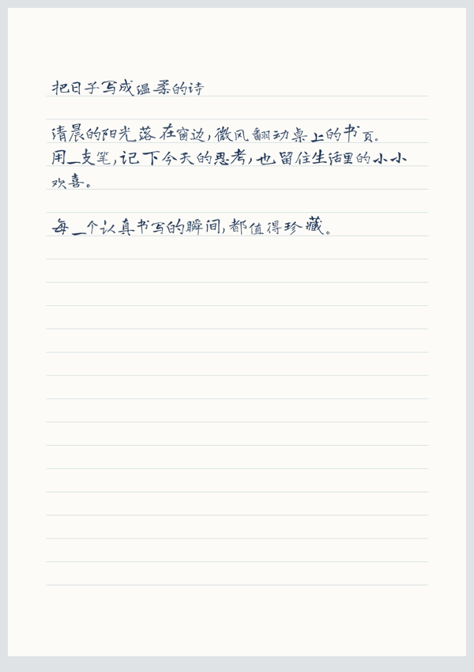

# 中文手写工作室 · Chinese Handwriting Studio

将文字生成带有自然变化的中文手写页面，输出 PNG、透明墨迹、PDF 和模拟拍照图。支持参考字迹参数、个人字形样本、连写词组和自定义纸张。安装依赖后可离线运行。

An offline Codex skill and Python CLI for Chinese handwriting simulation, reference-image style measurements, multi-sample glyph banks, custom paper and PNG/PDF export.



上图由仓库内的公开示例文字和内置字体生成。完整页面见 [examples/page.png](examples/page.png)，拍照效果见 [examples/photo.jpg](examples/photo.jpg)。

## 功能

- **整页排版**：保留文字顺序，自动换行和分页，提供整齐、自然、随写三种预设。
- **字形变化**：调整字号、角度、基线、间距、局部笔画形变和墨色，支持固定随机种子。
- **参考字迹**：从图片估计墨色、倾斜和尺寸变化，生成可复用的风格参数。
- **个人字库**：从已标注图片裁取单字或连写词组，同一内容支持多个样本并轮换使用。
- **纸张适配**：白纸、横线纸、方格纸、自定义图片、书写区域和透视四边形。
- **输出校验**：保存排版记录、输入及输出哈希、字体许可哈希和文字顺序检查结果。

## 环境与安装

需要 Python **3.10 或更高版本**，依赖为 Pillow、NumPy、ReportLab。仓库附带六款字体及各自的 SIL Open Font License，下载体积约 44 MB。

### 作为 Codex 技能使用

将仓库克隆到个人技能目录下的 `chinese-handwriting-studio` 文件夹。已有同名安装时，先备份或改用单独目录检查新版本。

Windows PowerShell：

```powershell
$SkillRoot = Join-Path $env:USERPROFILE '.codex\skills\chinese-handwriting-studio'
git clone https://github.com/Tenon520/chinese-handwriting-studio.git $SkillRoot
Set-Location $SkillRoot
python -m venv .venv
.\.venv\Scripts\python.exe -m pip install -r requirements.txt
```

macOS / Linux：

```bash
git clone https://github.com/Tenon520/chinese-handwriting-studio.git ~/.codex/skills/chinese-handwriting-studio
cd ~/.codex/skills/chinese-handwriting-studio
python3 -m venv .venv
.venv/bin/python -m pip install -r requirements.txt
```

安装后在新对话中调用：

```text
使用 $chinese-handwriting-studio，把这段文字生成自然中文手写页，使用横线纸，并导出 PNG 和 PDF。
```

技能入口为 [SKILL.md](SKILL.md)。参考图、纸张或个人样本可随具体任务提供。

### 直接使用命令行

也可将仓库克隆到任意目录，按上方步骤建立虚拟环境并安装依赖。以下命令在仓库根目录执行，每次选择新的输出目录。

Windows：

```powershell
.\scripts\run.ps1 page --input examples/text.txt --font-id longcang --preset natural --seed 20261026 --photo --pdf --output outputs/demo
.\scripts\run.ps1 validate --manifest outputs/demo/manifest.json
```

macOS / Linux：

```bash
.venv/bin/python scripts/studio.py page --input examples/text.txt --font-id longcang --preset natural --seed 20261026 --photo --pdf --output outputs/demo
.venv/bin/python scripts/studio.py validate --manifest outputs/demo/manifest.json
```

Windows 启动脚本依次选择项目 `.venv`、Codex 随附 Python、系统 `python`。使用其他环境时，可直接用该环境的 Python 执行 `scripts/studio.py`。

## 常用操作

以下示例中的 `python` 指已安装依赖的 Python。

测量参考字迹并应用参数：

```bash
python scripts/studio.py analyze-reference --image reference.jpg --crop 80,140,900,600 --output outputs/style
python scripts/studio.py page --input examples/text.txt --style outputs/style/style.json --output outputs/styled
```

裁取自己的字形样本：

```json
{"cells": [
  {"text": "的", "box": [20, 30, 90, 100]},
  {"text": "的", "box": [130, 30, 90, 100]},
  {"text": "自然", "box": [20, 150, 210, 100]}
]}
```

将上述映射按实际图片坐标保存为 `cells.json`，然后执行：

```bash
python scripts/studio.py extract-glyphs --image sheet.jpg --mapping cells.json --output outputs/my-bank
python scripts/studio.py page --input text.txt --glyph-bank outputs/my-bank/bank.json --output outputs/personal
```

检查字库中的 `preview.png`，确保标签与字形匹配。字库使用最长词组匹配，同一词条有多个样本时避免相邻重复；其余字符由选定字体生成。

适配空白纸张：

```bash
python scripts/studio.py page --input text.txt --template blank.jpg --box 110,280,1020,1260 --font-size 34 --line-height 62 --output outputs/custom
```

`--box` 使用 `x,y,宽,高`；拍摄纸张可用 `--quad` 指定顺时针四角，从左上角开始。坐标基于 EXIF 方向校正后的图片。

## 内置字体

| 参数 | 字体 | 风格 |
|---|---|---|
| `longcang` | Long Cang | 自然随写，默认 |
| `zhimangxing` | Zhi Mang Xing | 行书 |
| `xiaolai` | Xiaolai | 日常笔记 |
| `mashanzheng` | Ma Shan Zheng | 厚重题字 |
| `liujianmaocao` | Liu Jian Mao Cao | 草书 |
| `zcoolkuaile` | ZCOOL KuaiLe | 轻松活泼 |

渲染前检查字符覆盖和字体哈希。需要其他字体时使用 `--font path/to/font.ttf`，并遵守相应字体许可。

## 输出与验证

| 文件 | 用途 |
|---|---|
| `page_001.png` | 纸张与字迹合成页 |
| `ink_001.png` | 透明墨迹层 |
| `photo_001.jpg` | 可选模拟拍照图 |
| `handwriting.pdf` | 可选 PDF |
| `preview.png` | 页面缩略总览 |
| `layout.json` | 字符、字库样本和位置记录 |
| `manifest.json` | 参数、哈希和校验记录 |

同一输入、环境和种子可复现 PNG 像素。PDF 元数据可能随生成时间变化。运行校验后，还应检查整页的字形、留白和纸张对齐。

本地功能验证：

```bash
python tests/smoke.py
```

测试覆盖字体及许可与第三方代码哈希、整页 PNG/PDF/拍照输出、文字顺序、固定种子复现、字库词组与样本轮换、模板保留和文件篡改检测。测试使用临时合成样本。

## 数据与使用

个人字迹、纸张原图和生成文件建议放在 `private/` 或 `outputs/`；这两个目录已加入忽略规则。`layout.json` 和渲染图片会显示输入文字，分享前请检查内容。公开示例使用通用文字与内置字体。

参考参数用于估计墨色和变化幅度，个人字形通过已标注的裁切样本复用。适用于个人笔记、学习材料和设计展示；生成结果应标明为手写模拟，避免伪造签名、授权或身份材料。

## 来源与许可

基于 [kinrooo/chinese-handwriting-generator](https://github.com/kinrooo/chinese-handwriting-generator) 扩展，保留其渲染器、字体清单与来源记录。Studio 扩展加入参考图分析、字库、连写词组、模板透视与独立拍照输出。

- 项目代码：[Apache-2.0](LICENSE)
- Handright Beta：BSD-3-Clause，见 [完整许可](scripts/vendor/handrightbeta/LICENSE.txt)
- 六款字体：SIL Open Font License 1.1，各字体目录保留原许可与版权信息
- 完整归属：[THIRD_PARTY_NOTICES.md](THIRD_PARTY_NOTICES.md)
- 进阶命令：[references/studio-usage.md](references/studio-usage.md)
- 来源记录：[references/upstream-provenance.md](references/upstream-provenance.md)
